# AutoLoc — location de voitures en ligne

> Projet réalisé en groupe par **Hans-Kevin BEBADA**, **Hanniel DEGBELO** et **Aboubakar MFONZIE** dans le cadre du module **UP ASI — Architecture des Systèmes d'Information** (ECE, 2026-2027).


**AutoLoc** est une application complète de location de voitures. Elle comprend :

- un **site web** pour trouver une voiture disponible à vos dates et la réserver en quelques clics ;
- un **espace client** pour retrouver toutes ses réservations ;
- un **espace agence** pour suivre les locations, encaisser les paiements et enregistrer les retours ;
- tout ce qu'il faut « sous le capot » pour que cela fonctionne de façon **fiable et sûre** : une base de données, la sécurité des comptes, la surveillance de l'application et **180 tests automatiques**.

Ce document s'adresse à tout le monde : vous n'avez pas besoin d'être développeur pour le lire. Les mots techniques sont expliqués dans le [petit lexique](#14-petit-lexique) à la fin.

---

## Sommaire

1. [AutoLoc en deux minutes](#1-autoloc-en-deux-minutes)
2. [Visite guidée en images](#2-visite-guidée-en-images)
3. [Installer et lancer le projet](#3-installer-et-lancer-le-projet)
4. [Les comptes pour essayer](#4-les-comptes-pour-essayer)
5. [Comment c'est construit](#5-comment-cest-construit)
6. [Les données](#6-les-données)
7. [La sécurité, expliquée simplement](#7-la-sécurité-expliquée-simplement)
8. [La surveillance de l'application](#8-la-surveillance-de-lapplication)
9. [Les tests automatiques](#9-les-tests-automatiques)
10. [Organisation des fichiers](#10-organisation-des-fichiers)
11. [Correspondance avec le TP](#11-correspondance-avec-le-tp)
12. [En cas de problème](#12-en-cas-de-problème)
13. [Pour aller plus loin](#13-pour-aller-plus-loin)
14. [Petit lexique](#14-petit-lexique)
15. [Crédits](#15-crédits)

---

## 1. AutoLoc en deux minutes

### Qui peut faire quoi ?

| Vous êtes… | Vous pouvez… |
|---|---|
| **Un visiteur** | Voir la flotte de véhicules en temps réel, chercher les voitures libres à vos dates, réserver **sans créer de compte**. Vous recevez un **code de réservation** pour la retrouver ou l'annuler plus tard. |
| **Un client avec un compte** | Vous connecter avec votre adresse e-mail, retrouver **toutes** vos réservations (en cours, à venir, passées), réserver sans ressaisir vos informations, réinitialiser votre mot de passe si vous l'oubliez. |
| **Un agent de l'agence** | Voir le tableau de bord (réservations actives, chiffre d'affaires, taux d'occupation), encaisser un acompte ou le solde, enregistrer le retour d'un véhicule, annuler une réservation. |
| **Un développeur ou un enseignant** | Interroger l'API, lancer les tests, suivre l'activité de l'application dans des tableaux de bord (Prometheus et Grafana), lire la documentation technique. |

### Les règles de location

- On ne peut pas réserver dans le passé, ni plus d'**un an** à l'avance.
- Une location dure au moins **1 jour** et au plus **30 jours**.
- Le **prix** = tarif journalier × nombre de jours. Il est **toujours calculé par le serveur** : personne ne peut le modifier depuis son navigateur.
- Une voiture **en maintenance** ne peut pas être réservée, et une voiture ne peut jamais être réservée deux fois sur la même période, même si deux personnes cliquent au même instant.
- Une voiture rendue un jour donné peut repartir **le jour même** avec un autre client.
- Le client peut **annuler** tant que la location n'a pas commencé.
- **Pas de paiement en ligne** : le client règle à l'agence, et l'agent enregistre le paiement.

---

## 2. Visite guidée en images

> Les captures montrent les **données de démonstration** chargées au premier lancement : une agence à Paris, trois voitures (une Renault Clio, une Peugeot 508 et un Dacia Duster) et une cliente, Léa Durand.

### 2.1 Chercher une voiture

Sur la page d'accueil, l'encadré bleu **« Planifiez votre location »** permet de choisir une date de départ, une date de retour et, si on le souhaite, une catégorie (citadine, berline, SUV, utilitaire). En bas de l'encadré, on voit l'état de l'application (« En ligne »), vérifié toutes les 15 secondes.

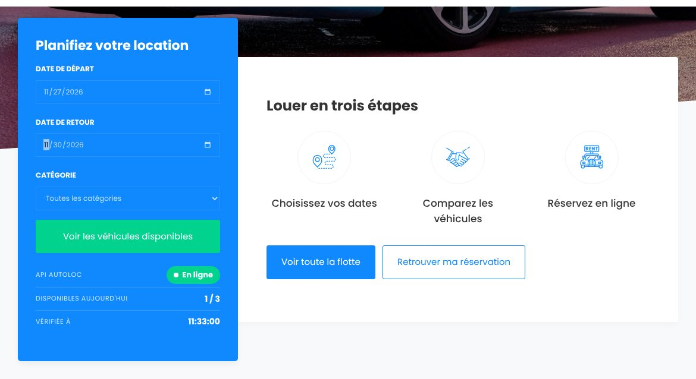

La flotte s'affiche alors avec, pour chaque voiture, sa disponibilité **sur vos dates** et le **prix total** de la location. Des filtres permettent de n'afficher que les voitures disponibles ou une catégorie.

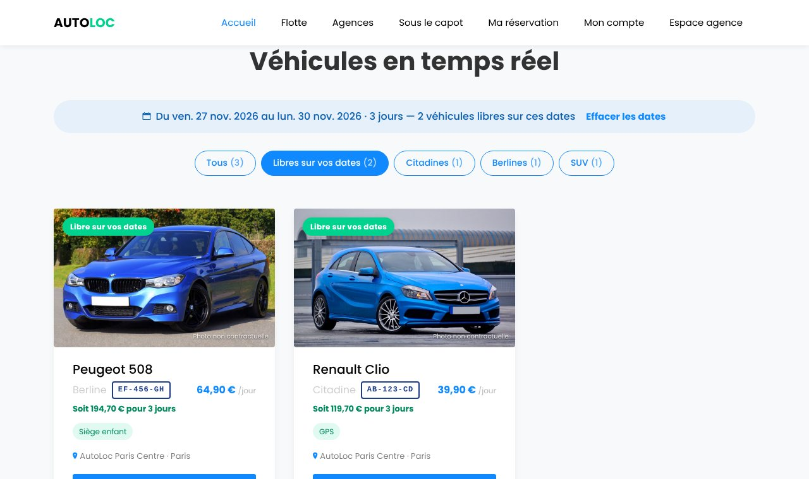

### 2.2 Réserver sans compte

Le bouton **« Réserver »** ouvre le formulaire. On y voit :

- les périodes **déjà réservées** pour cette voiture ;
- le **prix**, recalculé par le serveur à chaque changement de date.

Chaque champ est vérifié, et un message clair s'affiche sous le champ en cas d'erreur.

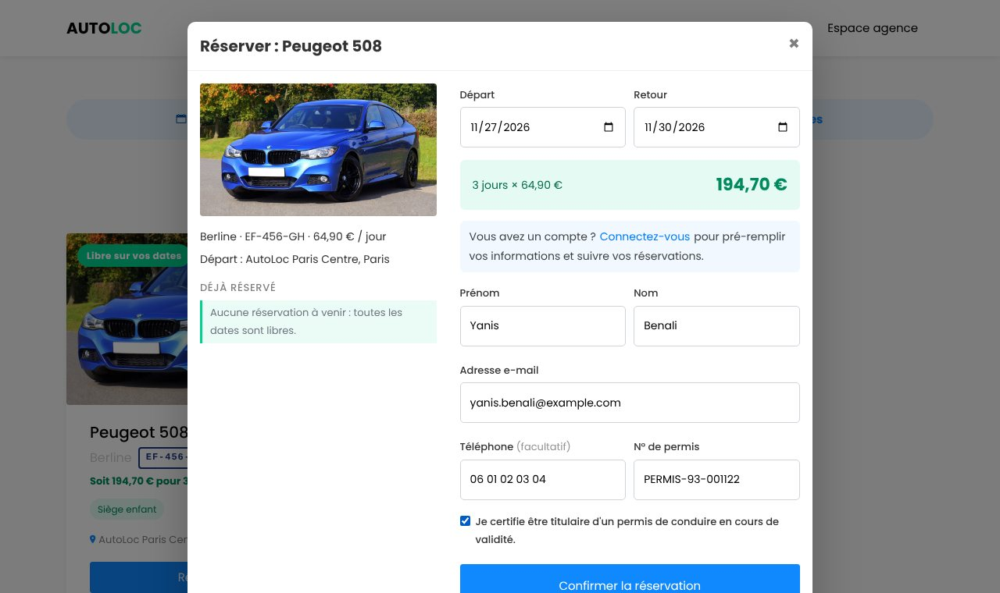

Une fois la réservation confirmée, le site affiche un **code de réservation secret** de 10 caractères (par exemple `M39PF-XACQW`). Avec l'adresse e-mail, c'est lui qui permet de retrouver ou d'annuler la réservation. Le numéro de réservation seul ne suffit pas : les numéros se suivent (1, 2, 3…), donc n'importe qui pourrait les deviner.

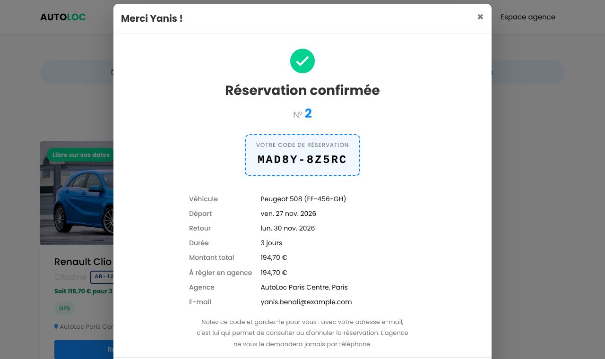

### 2.3 Retrouver ou annuler sa réservation

Le menu **« Ma réservation »** demande le code et l'adresse e-mail. Il affiche ensuite le détail de la réservation :

- le véhicule ;
- les dates ;
- le montant, ce qui est déjà réglé et ce qui reste à payer ;
- l'agence.

On peut **annuler** tant que la location n'a pas commencé.

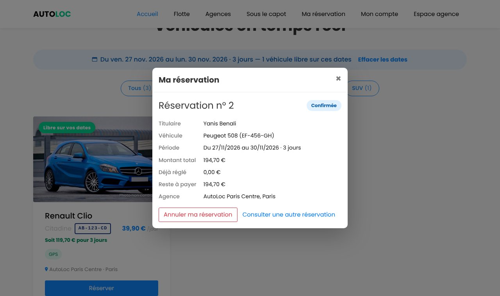

### 2.4 Le compte client (facultatif)

Le menu **« Mon compte »** permet de se connecter avec son adresse e-mail, de créer un compte, ou de demander un nouveau mot de passe.

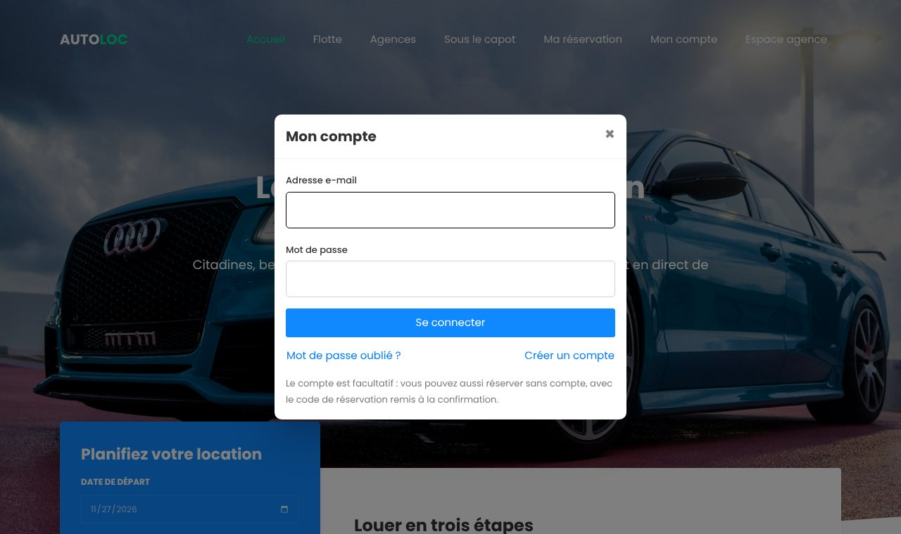

**Créer un compte se fait en deux temps, pour votre sécurité.**

1. Vous donnez seulement votre adresse e-mail. Vous recevez un lien pour la confirmer, valable 24 heures.
2. En ouvrant ce lien, vous complétez vos informations et **choisissez alors votre mot de passe**. Les règles du mot de passe s'affichent et se cochent au fur et à mesure.

Si vous aviez déjà réservé sans compte avec cette adresse, vos réservations sont automatiquement rattachées à votre nouveau compte.

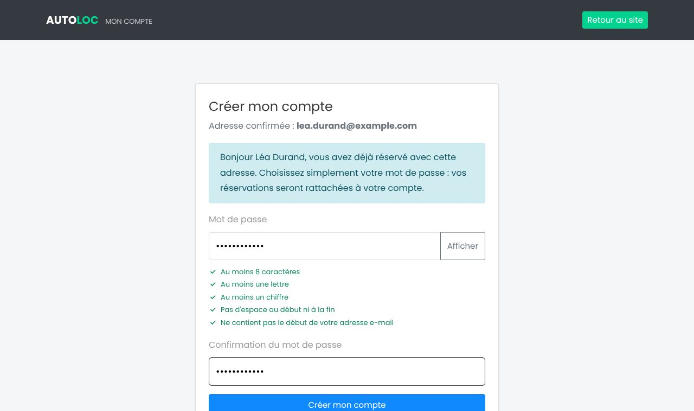

Une fois connecté, **« Mon espace »** classe toutes vos réservations en trois groupes : *En cours*, *À venir*, *Passées et annulées*. Le formulaire de réservation se remplit tout seul avec vos informations.

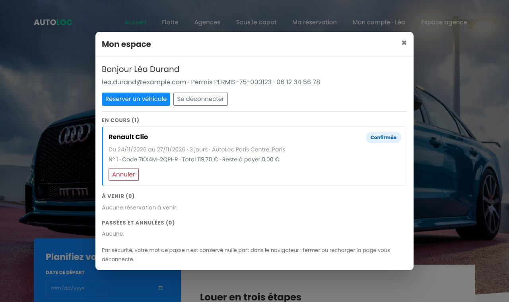

### 2.5 Mot de passe oublié

Depuis la fenêtre de connexion (côté client) ou l'espace agence, **« Mot de passe oublié ? »** envoie un lien par e-mail. Ce lien ne sert qu'**une seule fois** et pendant **30 minutes**. Il ouvre la page où l'on choisit un nouveau mot de passe.

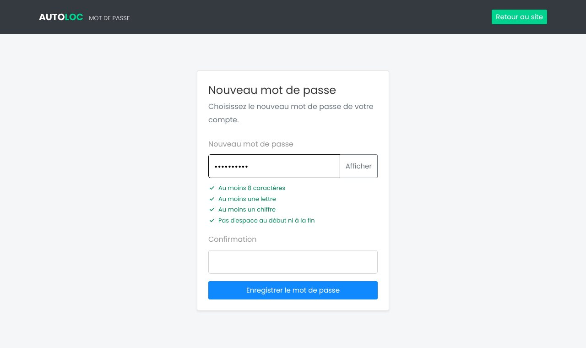

> **Où arrivent les e-mails ?** En développement, l'application n'envoie **rien sur Internet** : les e-mails arrivent dans **Mailpit**, une boîte de réception de test qui tourne sur votre ordinateur, à l'adresse <http://localhost:8025>.

### 2.6 L'espace agence

Réservé au personnel (compte `admin`), il est accessible par le menu **« Espace agence »**. On y trouve :

- **4 indicateurs** : réservations actives, chiffre d'affaires, montant encaissé, taux d'occupation de la flotte ;
- **la liste de toutes les réservations**, avec un filtre et une recherche (nom, e-mail ou plaque) ;
- **3 actions** : **Encaisser** (un acompte ou le solde), **Terminer** (retour du véhicule), **Annuler**.

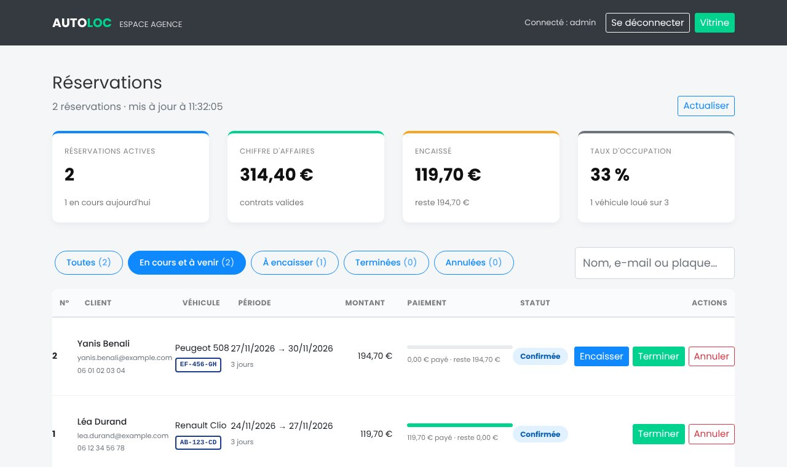

### 2.7 Sur téléphone

Tout le site s'adapte aux petits écrans.

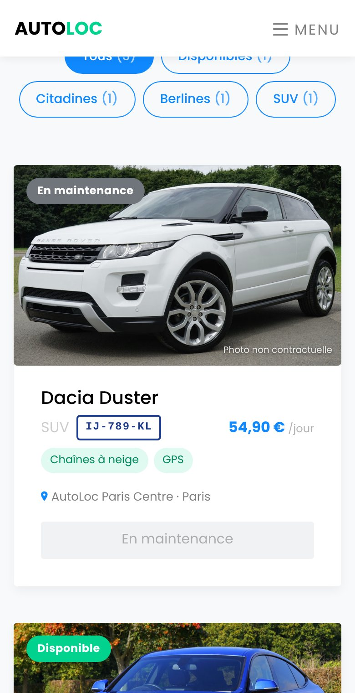

---

## 3. Installer et lancer le projet

### 3.1 Ce qu'il faut installer

| Outil | À quoi il sert | Obligatoire ? |
|---|---|---|
| **Java 17 ou plus récent** (JDK) | Faire tourner l'application. | Oui |
| **XAMPP** (avec MySQL / MariaDB) | La base de données où sont enregistrés les véhicules, les clients et les réservations. | Oui |
| **Docker Desktop** | Lancer les outils de surveillance (Prometheus, Grafana) et la boîte e-mail de test (Mailpit). | Non, mais conseillé |
| **Git** | Récupérer le projet depuis GitHub. | Non (on peut télécharger le zip) |

Maven, l'outil qui compile le projet, **n'a pas besoin d'être installé** : le projet contient son propre lanceur (`mvnw`), qui le télécharge automatiquement la première fois.

### 3.2 Récupérer le projet

Avec Git :

```bash
git clone https://github.com/Kevbbd/AutoLoc.git
```

Sans Git : sur la page GitHub du projet, cliquez sur **Code › Download ZIP**, puis décompressez le fichier.

### 3.3 Lancer en un double-clic (Windows)

1. Ouvrez le **panneau XAMPP** et cliquez sur **Start** à côté de **MySQL**.
2. *(Facultatif)* Lancez **Docker Desktop** et attendez qu'il soit prêt.
3. Dans le dossier `autoloc-api`, double-cliquez sur **`LANCER-TOUT.cmd`**.
4. Patientez. Le premier lancement télécharge les dépendances et peut prendre **plusieurs minutes**, les suivants environ une minute.
5. À la fin, le site **s'ouvre tout seul** dans votre navigateur.

Le script enchaîne 6 étapes et écrit le détail de chacune dans le dossier `autoloc-api\logs\` :

| Étape | Ce qu'elle fait |
|---|---|
| 0 — Arrêt | Arrête une ancienne version encore ouverte. |
| 1 — Diagnostic | Vérifie que Java, MySQL, Docker et Git sont présents. |
| 2 — Compilation et tests | Construit l'application et lance les **180 tests**. Si un test échoue, le script s'arrête. |
| 3 — Démarrage | Lance l'application dans une fenêtre réduite **« AutoLoc API »**. |
| 4 — Base de données | Affiche les tables et les dernières réservations (`logs\base.log`). |
| 5 — Sécurité | Rejoue la matrice des droits d'accès : qui peut ouvrir quelle page (`logs\securite.log`). |
| 6 — Surveillance | Démarre Prometheus, Grafana et Mailpit si Docker tourne. |

### 3.4 Les adresses utiles

| Adresse | Ce qu'on y trouve |
|---|---|
| <http://localhost:8080> | Le site AutoLoc. |
| <http://localhost:8080/admin.html> | L'espace agence. |
| <http://localhost:8080/swagger-ui.html> | Swagger UI : la documentation interactive de l'API, pour tester chaque route (bouton « Authorize » : `student` / `student123` ou `admin` / `admin123`). |
| <http://localhost:8025> | Mailpit : les e-mails envoyés par l'application. |
| <http://localhost:3000> | Grafana : les tableaux de bord (identifiants `admin` / `admin`). |
| <http://localhost:9090> | Prometheus : la collecte des mesures. |

### 3.5 Arrêter

- **L'application :** fermez la fenêtre **« AutoLoc API »** dans la barre des tâches.
- **La surveillance :** double-cliquez sur `autoloc-api\scripts\monitoring-arreter.cmd`.

### 3.6 Sans Windows, ou en ligne de commande

Depuis le dossier `autoloc-api`, MySQL étant démarré :

```bash
./mvnw test                                                  # lancer les tests
./mvnw spring-boot:run -Dspring-boot.run.profiles=dev        # démarrer avec les données de démonstration
docker compose up -d                                         # démarrer la surveillance et Mailpit
```

Si votre MySQL a un mot de passe, donnez-le dans la variable d'environnement `DB_PASSWORD`. Il n'est **jamais** écrit dans le code.

---

## 4. Les comptes pour essayer

| Compte | Identifiant | Mot de passe | Rôle |
|---|---|---|---|
| Administrateur de l'agence | `admin` (e-mail `admin@autoloc.test`) | `admin123` | Accès à l'espace agence. |
| Utilisateur du TP | `student` (e-mail `student@autoloc.test`) | `student123` | Accès à l'API, pas à l'espace agence. |
| Cliente de démonstration | Léa Durand, `lea.durand@example.com` | aucun au départ | Elle a déjà une réservation, faite sans compte. Créez son compte avec cette adresse : la réservation apparaîtra dans « Mon espace ». |

> Ces identifiants sont ceux imposés par l'énoncé du TP. Dans une vraie entreprise, aucun mot de passe ne serait écrit dans le code ni dans la documentation.

Pour **créer votre propre compte client**, utilisez n'importe quelle adresse e-mail (par exemple `vous@exemple.test`). L'e-mail de confirmation arrivera dans Mailpit (<http://localhost:8025>), jamais dans votre vraie boîte.

---

## 5. Comment c'est construit

### 5.1 Vue d'ensemble

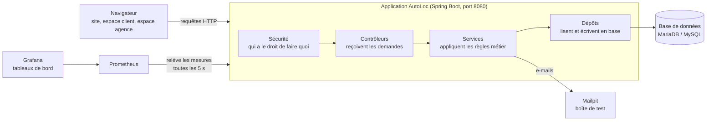

On peut comparer l'application à un **restaurant** :

- **la sécurité**, c'est le portier : il vérifie qui entre et où chacun a le droit d'aller ;
- **les contrôleurs**, ce sont les serveurs : ils prennent la commande et la vérifient (un champ manque ? une date est mal écrite ?) ;
- **les services**, c'est la cuisine : c'est là que les règles sont appliquées (la voiture est-elle libre ? combien ça coûte ?) ;
- **les dépôts**, c'est la réserve : ils vont chercher et ranger les données dans la base.

Chaque couche a un seul rôle, ce qui rend le code plus simple à comprendre, à tester et à faire évoluer.

### 5.2 Exemple : ce qui se passe quand on réserve

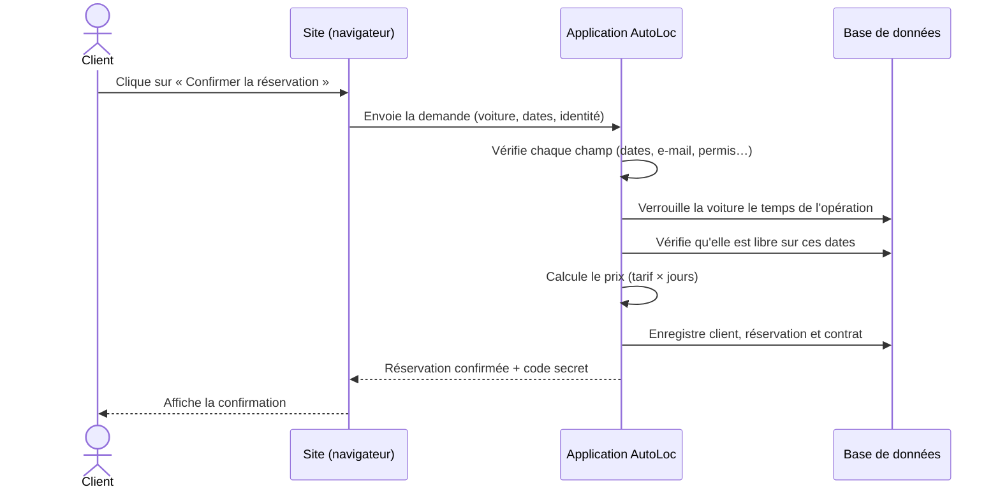

Le **verrou** est important : si deux personnes réservent la même voiture au même instant, la seconde attend que la première ait fini, puis voit que la voiture est prise. C'est vérifié par un test qui lance **8 réservations simultanées** : une seule réussit.

### 5.3 Les technologies

| Technologie | Rôle dans le projet |
|---|---|
| **Java 17** | Le langage de programmation de l'application. |
| **Spring Boot 4.2** | Le cadre qui assemble l'application : serveur web, configuration, démarrage. |
| **Spring Data JPA / Hibernate 7** | Fait le lien entre les objets Java et les tables de la base, sans écrire de SQL à la main. |
| **Spring Security 7** | Connexion, rôles, mots de passe chiffrés, protections contre les attaques. |
| **MariaDB / MySQL** (XAMPP) | La base de données réelle. |
| **H2** | Une base de données en mémoire, utilisée uniquement par les tests. |
| **Lombok** | Génère automatiquement le code répétitif (accesseurs, constructeurs). |
| **Actuator + Micrometer** | Exposent l'état de santé et les mesures de l'application. |
| **Prometheus + Grafana** | Collectent ces mesures et les affichent en graphiques. |
| **springdoc-openapi / Swagger UI** | Génère la documentation de l'API à partir du code et permet d'essayer chaque route dans le navigateur. |
| **Mailpit** | Boîte e-mail de test. |
| **Docker Compose** | Lance Prometheus, Grafana et Mailpit en une commande. |
| **HTML, CSS, JavaScript** (modèle Carbook, Bootstrap, jQuery) | Les pages du site. |
| **JUnit 5 + AssertJ** | Les tests automatiques. |

---

## 6. Les données

L'application enregistre ses données dans **13 tables**. Voici les principales et leurs liens :

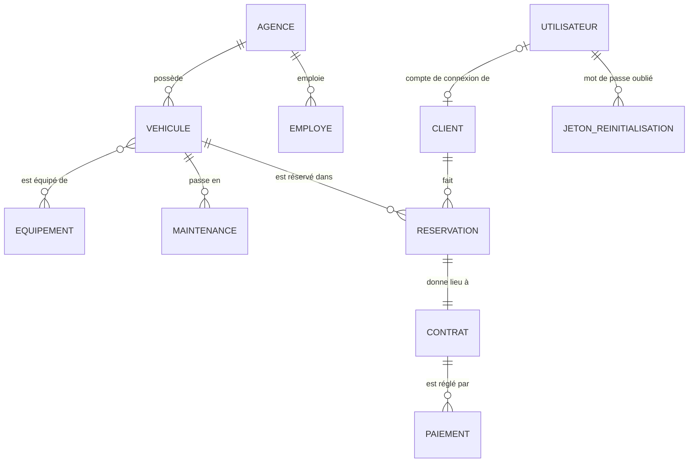

| Table | Ce qu'elle contient |
|---|---|
| `agence` | Les agences : nom, ville, adresse, téléphone. |
| `vehicule` | Les voitures : plaque, marque, modèle, catégorie, tarif par jour, statut (disponible, louée, en maintenance). |
| `equipement`, `vehicule_equipement` | Les équipements (GPS, siège enfant, chaînes à neige…) et quelles voitures les ont. |
| `employe` | Le personnel des agences. |
| `maintenance` | Les passages à l'atelier. |
| `client` | Les clients : nom, prénom, e-mail, téléphone, numéro de permis. |
| `reservation` | Qui loue quelle voiture, de quand à quand, le statut et le code secret. |
| `contrat` | Le montant total et la validité du contrat de chaque réservation. |
| `paiement` | Chaque paiement encaissé : montant, date, mode (carte, espèces, virement). |
| `utilisateur` | Les comptes de connexion (personnel et clients), avec leur mot de passe **chiffré**. |
| `jeton_reinitialisation`, `jeton_inscription` | Les liens envoyés par e-mail (mot de passe oublié, création de compte), stockés sous une forme qui ne permet pas de les reconstituer. |

**La vie d'une réservation :**

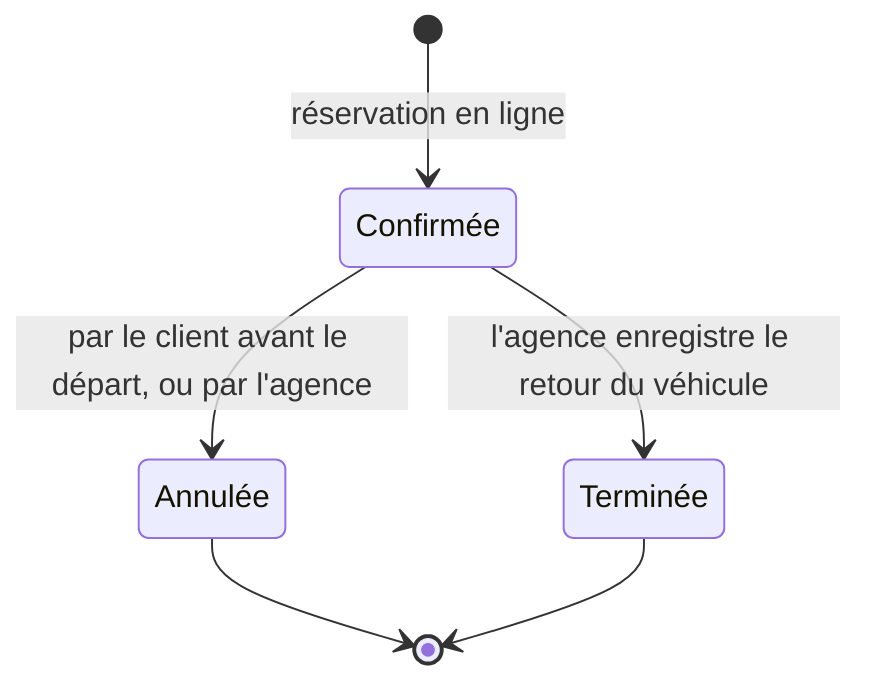

La base est **créée automatiquement** au premier lancement : il n'y a aucun script SQL à exécuter.

---

## 7. La sécurité, expliquée simplement

La sécurité a fait l'objet d'un **audit complet**. Voici, en termes simples, chaque risque et la protection mise en place :

| Le risque | La protection |
|---|---|
| Quelqu'un vole la base de données et lit les mots de passe. | Les mots de passe ne sont **jamais** stockés en clair : seule une empreinte **BCrypt** est gardée, et on ne peut pas retrouver le mot de passe à partir d'elle. |
| Quelqu'un essaie des milliers de mots de passe. | Après **5 erreurs en 15 minutes**, le compte est bloqué 15 minutes, et un même ordinateur est bloqué après 20 erreurs. |
| Un client ouvre l'espace agence. | Chaque compte a un **rôle** (client, utilisateur, administrateur). Les pages et l'API vérifient ce rôle à chaque demande. |
| Quelqu'un consulte ou annule la réservation d'un autre. | Il faut le **code secret** de 10 caractères (environ 800 000 milliards de possibilités) **et** l'adresse e-mail. Un client connecté ne voit que ses propres réservations. |
| Quelqu'un crée un compte avec l'adresse e-mail d'un autre. | L'adresse doit être confirmée par un lien, et le mot de passe n'est choisi **qu'après** cette confirmation. |
| Un lien de « mot de passe oublié » est intercepté. | Il expire après **30 minutes**, ne sert qu'**une fois**, et n'est stocké en base que sous une forme irréversible. |
| Quelqu'un cherche à savoir qui a un compte. | Le site répond **le même message** que l'adresse existe ou non. |
| Un robot envoie des formulaires en masse. | Au-delà de **30 envois par minute** depuis un même ordinateur, les demandes sont refusées. |
| Un script malveillant est injecté dans une page. | Une politique de sécurité stricte (**CSP**) n'autorise que les scripts du site lui-même, et les données ne sont jamais insérées comme du code. |
| Quelqu'un modifie le prix dans son navigateur. | Le prix est **toujours recalculé par le serveur**. |

**Ce qui est volontairement simplifié**, parce que tout tourne sur votre ordinateur pour le TP :

- le site est en `http` et non en `https` ;
- le MySQL de XAMPP n'a pas de mot de passe ;
- les comptes du TP sont connus de tous.

En production, ces points seraient corrigés. La liste détaillée se trouve dans [`autoloc-api/docs/security-notes.md`](autoloc-api/docs/security-notes.md).

### Vérifier les droits soi-même avec Swagger UI

L'application démarrée, ouvrez <http://localhost:8080/swagger-ui.html>. Dans le groupe **« Démonstration du TP »**, cliquez sur **Execute** sous une route : sans compte, `/api/hello` répond **401**. Cliquez ensuite sur **Authorize**, connectez-vous avec `student` / `student123`, puis réessayez : `/api/hello` répond **200** et `/api/admin/report` répond **403**, car student n'est pas administrateur. Avec `admin` / `admin123`, `/api/admin/report` répond **200**.

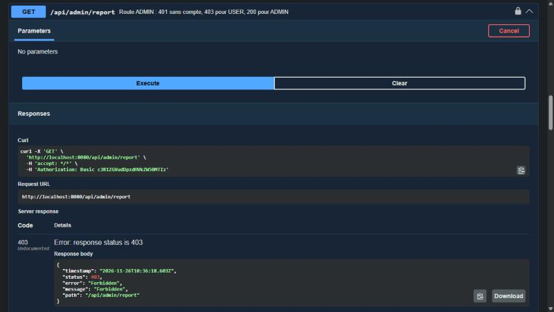

---

## 8. La surveillance de l'application

Une application qui tourne doit être **surveillée** : est-elle en ligne ? répond-elle vite ? combien d'erreurs ? Trois outils s'en chargent :

1. **Actuator** : l'application publie elle-même ses mesures (nombre de requêtes, temps de réponse, mémoire utilisée, connexions à la base…) à l'adresse `/actuator/prometheus`.
2. **Prometheus** : il relève ces mesures **toutes les 5 secondes** et les garde en mémoire.
3. **Grafana** : il les affiche dans un **tableau de bord** prêt à l'emploi, *AutoLoc — Application Monitoring* (menu *Dashboards › AutoLoc*).

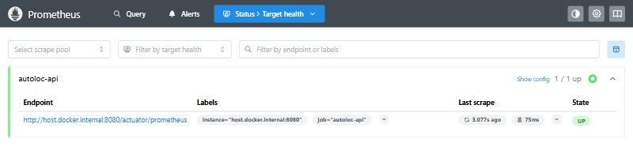

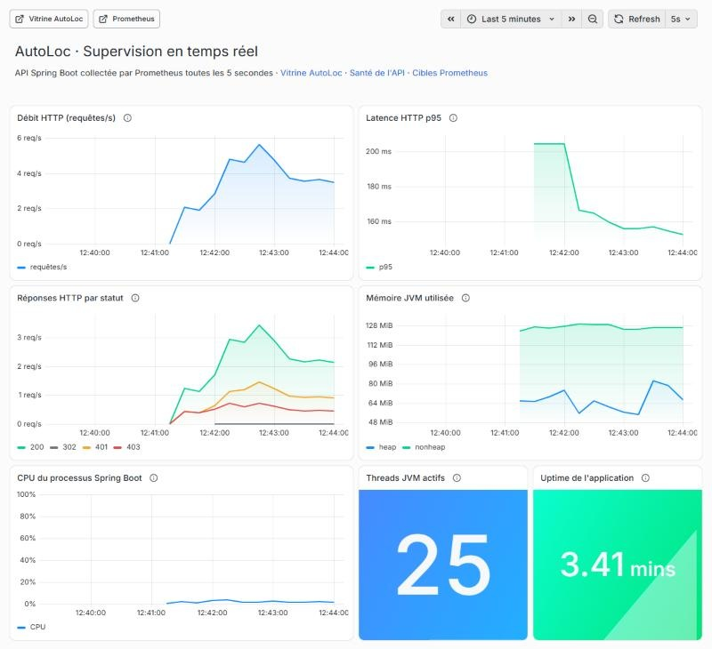

Les trois se lancent ensemble avec Docker (étape 6 de `LANCER-TOUT.cmd`). Le détail des mesures et des requêtes se trouve dans [`autoloc-api/docs/monitoring-notes.md`](autoloc-api/docs/monitoring-notes.md).

---

## 9. Les tests automatiques

Le projet contient **180 tests automatiques**. Ils vérifient tout seuls, en une minute environ, que l'application se comporte comme prévu. Ils sont lancés à chaque `LANCER-TOUT.cmd`, et peuvent l'être seuls avec `scripts\tests.cmd` ou `./mvnw test`.

| Type de test | Exemples de ce qui est vérifié |
|---|---|
| **Règles métier** (sans base) | Deux périodes se chevauchent-elles ? Le prix est-il bien arrondi ? Un paiement peut-il dépasser le reste à payer ? |
| **Base de données** | Les requêtes trouvent-elles les bonnes voitures libres, cas limites compris ? Supprimer un contrat supprime-t-il ses paiements ? |
| **Application complète** (vraies requêtes HTTP) | Une réservation complète, les erreurs (dates invalides, voiture déjà prise), la création de compte, le mot de passe oublié, le blocage après 5 erreurs, les droits d'accès de chaque rôle. |
| **Accès simultanés** | 8 réservations simultanées de la même voiture : une seule réussit. 8 utilisations simultanées d'un même lien e-mail : une seule fonctionne. |

Les tests utilisent une base **H2 en mémoire** : ils ne touchent jamais à vos vraies données.

---

## 10. Organisation des fichiers

```
AutoLoc/
├── README.md                    ce document
├── captures/                    les captures d'écran : site, Swagger UI, Prometheus et Grafana
└── autoloc-api/                 l'application
    ├── LANCER-TOUT.cmd          tout lancer et tout vérifier, en un double-clic (Windows)
    ├── PUBLIER-SUR-GITHUB.cmd   publier le projet sur GitHub
    ├── README.md                documentation technique (pour développeurs)
    ├── pom.xml                  liste des bibliothèques utilisées (Maven)
    ├── docker-compose.yml       Prometheus, Grafana et Mailpit
    ├── docs/                    documentation détaillée (sécurité, réservation, JPA, monitoring) + collection Postman
    ├── monitoring/              configuration de Prometheus et du tableau de bord Grafana
    ├── scripts/                 chaque étape de LANCER-TOUT, utilisable seule
    └── src/
        ├── main/java/…          le code de l'application
        │   ├── domain/          les objets métier : véhicule, client, réservation, contrat…
        │   ├── repository/      l'accès à la base de données
        │   ├── service/         les règles métier
        │   ├── web/             les points d'entrée de l'API
        │   ├── securite/        le blocage après échecs et la limitation des formulaires
        │   └── config/          la sécurité, la documentation Swagger, les comptes et les données de démonstration
        ├── main/resources/
        │   ├── application.properties   les réglages
        │   └── static/          les pages du site (HTML, CSS, JavaScript, images)
        └── test/                les 180 tests automatiques
```

---

## 11. Correspondance avec le TP

| Partie du TP | Ce qui a été réalisé | Où le trouver |
|---|---|---|
| **Workshop 1** : le socle | Projet Spring Boot, connexion à MySQL, première entité `Vehicule` | `pom.xml`, `domain/Vehicule.java` |
| **Workshop 2** : les entités et associations JPA | 9 entités reliées entre elles (agence, véhicule, client, réservation, contrat, paiement…), stratégies de chargement | `domain/`, `repository/`, [`docs/fetch-strategy.md`](autoloc-api/docs/fetch-strategy.md) |
| **Spring Security** | Connexion, rôles USER et ADMIN, routes publiques et protégées, matrice 200 / 401 / 403 | `config/SecurityConfig.java`, [`docs/security-notes.md`](autoloc-api/docs/security-notes.md), Swagger UI |
| **Session 3** : Docker et monitoring | Actuator, Prometheus, Grafana avec tableau de bord automatique | `docker-compose.yml`, `monitoring/`, [`docs/monitoring-notes.md`](autoloc-api/docs/monitoring-notes.md) |
| **Au-delà du TP** | Site de réservation complet, espace agence, comptes clients, mot de passe oublié, audit de sécurité, 180 tests | `static/`, `service/`, [`docs/reservation.md`](autoloc-api/docs/reservation.md) |

---

## 12. En cas de problème

| Ce que vous voyez | Que faire |
|---|---|
| « MySQL ne tourne pas » | Ouvrez le panneau XAMPP et cliquez sur **Start** à côté de MySQL, puis relancez. |
| « Le port 8080 est occupé » | Une autre application utilise le port 8080. Fermez-la (ou fermez l'ancienne fenêtre « AutoLoc API »), puis relancez. |
| La page reste blanche et « tourne » sans fin | Le navigateur a trop d'onglets bloqués sur `localhost:8080`. Fermez-les tous (ou fermez complètement le navigateur), puis rouvrez un seul onglet. |
| L'e-mail de confirmation ou de mot de passe n'arrive pas | C'est normal : il arrive dans **Mailpit** (<http://localhost:8025>), pas dans votre vraie boîte. Docker Desktop doit être lancé. Sans Docker, le lien est écrit dans `autoloc-api\logs\app.log`. |
| « Trop de tentatives de connexion » | 5 mauvais mots de passe ont été saisis : attendez 15 minutes, ou relancez l'application. |
| `admin123` ne fonctionne plus | Le mot de passe a été changé avec « Mot de passe oublié » : utilisez le nouveau, ou refaites une demande pour `admin@autoloc.test`. |
| « La compilation ou les tests ont échoué » | Le détail est dans `autoloc-api\logs\tests.log`. |

D'autres cas techniques sont traités dans la section *Dépannage* de [`autoloc-api/README.md`](autoloc-api/README.md#dépannage).

---

## 13. Pour aller plus loin

| Document | Contenu |
|---|---|
| [`autoloc-api/README.md`](autoloc-api/README.md) | Documentation technique : démarrage dans IntelliJ, liste complète des tests, choix techniques par rapport à l'énoncé. |
| [`docs/reservation.md`](autoloc-api/docs/reservation.md) | Règles métier, cycle de vie, gestion des accès simultanés, liste complète de l'API. |
| [`docs/security-notes.md`](autoloc-api/docs/security-notes.md) | Règles d'accès, comptes clients, mot de passe oublié, audit de sécurité complet. |
| [`docs/fetch-strategy.md`](autoloc-api/docs/fetch-strategy.md) | Associations JPA et stratégies de chargement des données. |
| [`docs/monitoring-notes.md`](autoloc-api/docs/monitoring-notes.md) | Actuator, Prometheus, Grafana et les requêtes des graphiques. |
| [`docs/postman/`](autoloc-api/docs/postman) | Collection Postman pour tester l'API à la main. |

---

## 14. Petit lexique

| Mot | Signification |
|---|---|
| **API** | La « porte d'entrée » de l'application pour les programmes : le site lui envoie des demandes (lister les voitures, réserver…) et reçoit des réponses. |
| **Base de données** | L'endroit où les informations sont rangées durablement, sous forme de tableaux (les *tables*). |
| **Serveur** | Le programme qui reçoit les demandes et y répond. Ici, l'application AutoLoc qui tourne sur votre ordinateur. |
| **`localhost`** | « Cet ordinateur-ci ». `localhost:8080` désigne l'application qui tourne sur votre propre machine, au port 8080. |
| **Spring Boot** | Un ensemble d'outils Java très répandu pour construire des applications web. |
| **Entité** | Un objet métier enregistré en base : un véhicule, un client, une réservation… |
| **Rôle** | Ce qu'un compte a le droit de faire : client, utilisateur ou administrateur. |
| **Empreinte (hachage)** | Une transformation à sens unique : on peut vérifier qu'un mot de passe correspond à son empreinte, mais pas retrouver le mot de passe à partir d'elle. |
| **Docker** | Un outil qui lance des logiciels prêts à l'emploi (ici Prometheus, Grafana, Mailpit) sans avoir à les installer un par un. |
| **Test automatique** | Un petit programme qui vérifie tout seul qu'une partie de l'application fonctionne comme prévu. |
| **CSP** | *Content Security Policy* : une règle envoyée au navigateur pour lui interdire d'exécuter des scripts venant d'ailleurs que du site. |
| **Codes 200, 401, 403** | Les réponses d'un serveur : 200 = « c'est bon », 401 = « qui êtes-vous ? » (pas connecté), 403 = « vous n'avez pas le droit ». |

---

## 15. Crédits

- **Réalisation :** Hans-Kevin BEBADA, Hanniel DEGBELO et Aboubakar MFONZIE, ECE, module UP ASI (2026-2027).
- **Modèle graphique du site :** [Carbook](https://colorlib.com) de Colorlib, licence CC BY 3.0. Le lien vers Colorlib en pied de page est conservé, comme l'exige la licence.
- **Police :** Poppins (Google Fonts).
- **Outils libres :** Spring Boot, Hibernate, MariaDB, Prometheus, Grafana, Mailpit, Bootstrap, jQuery, JUnit.
