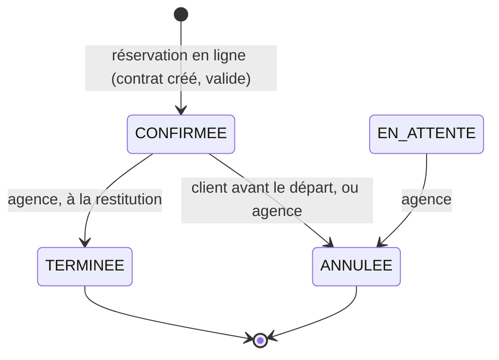

# Réservation en ligne — AutoLoc

Ce document décrit la fonctionnalité de réservation : le parcours, les règles métier, le cycle de vie d'une réservation, la gestion de la concurrence, l'API et les tests qui le prouvent.

## Les deux parcours

**Client (vitrine `http://localhost:8080`)**

1. Il choisit ses dates dans « Planifiez votre location ». La flotte indique, pour chaque véhicule, s'il est libre **sur ces dates** et le prix total.
2. « Réserver » ouvre le formulaire. Le prix est recalculé par le serveur à chaque changement de date, et les périodes déjà prises sont listées.
3. Après validation, il obtient un **code de réservation secret** (10 caractères, par exemple `V89GH-QDCJZ`) en plus du numéro.
4. « Ma réservation » (code + e-mail) affiche le détail : montant, déjà réglé, reste à payer. Il peut **annuler** tant que la location n'a pas commencé.
5. S'il le souhaite, il crée un **compte** (« Mon compte »). Connecté, il retrouve toutes ses réservations, y compris celles faites sans compte avec la même adresse, et le formulaire de réservation est pré-rempli et verrouillé à son identité. Voir [`security-notes.md`](security-notes.md#comptes-clients).

**Agence (`http://localhost:8080/admin.html`, compte `admin`)**

- Des indicateurs : réservations actives, chiffre d'affaires des contrats valides, montant encaissé, taux d'occupation de la flotte.
- La liste filtrable de toutes les réservations, avec une barre de progression du paiement.
- Trois actions : **Encaisser** (acompte ou solde), **Terminer** (restitution du véhicule), **Annuler**.

Il n'y a pas de paiement en ligne : le client règle en agence, l'agent enregistre le paiement.

## Règles métier

| Règle | Où elle est appliquée | Réponse si elle est violée |
|---|---|---|
| Une période est **semi-ouverte** `[départ, retour)` ; durée = retour − départ, au moins 1 jour | `Periode` (record du domaine) | 400, champ `dateFin` |
| Le départ n'est pas dans le passé | `ReglesLocation.periodeReservable` | 400, champ `dateDebut` |
| Le départ est au plus 365 jours à l'avance | idem | 400, champ `dateDebut` |
| Une location dure au plus 30 jours | idem | 400, champ `dateFin` |
| Un véhicule en maintenance ne se réserve pas | `ReservationService.motifIndisponibilite` | 409 |
| Deux réservations **actives** (en attente ou confirmée) d'un même véhicule ne se chevauchent jamais | idem + verrou (voir « Concurrence ») | 409 |
| Montant = tarif journalier × jours, arrondi au centime (`HALF_UP`) | `ReglesLocation.montant` | Le prix n'est **jamais** lu dans la requête : il est toujours calculé par le serveur. |
| Un e-mail et un numéro de permis désignent la même personne | `ReservationService.clientPour` | 409 (on ne peut pas réserver avec l'e-mail d'un autre client) |
| Le client annule seulement une réservation active qui n'a pas commencé | `Reservation.estAnnulableParClient` | 409 |
| Un paiement est > 0, au plus égal au reste à payer, sur un contrat valide | `Contrat.encaisser` | 400 (montant ≤ 0) ou 409 |
| Seule une réservation confirmée peut être terminée | `Reservation.terminer` | 409 |
| Un véhicule est `LOUE` tant qu'une réservation active couvre aujourd'hui | `ReservationService.reserver` et `libererVehiculeSiPossible` | — |

Les règles portant sur une seule entité (`Periode`, `Reservation.annuler`, `Contrat.encaisser`…) vivent **dans le domaine** : elles sont testées sans Spring et ne peuvent pas être contournées par un autre service. Les règles qui demandent la base ou l'horloge vivent dans le service.

« Aujourd'hui » vient d'un `java.time.Clock` injecté (`config/HorlogeConfig`) : les tests fixent la date au lieu de dépendre du jour où ils tournent.

## Cycle de vie d'une réservation



- Annuler invalide le contrat (`valide = false`) : plus aucun paiement ne peut y être enregistré, et il sort du chiffre d'affaires.
- Une location terminée garde un contrat valide : l'agence peut encore encaisser un solde après la restitution.
- `EN_ATTENTE` existe dans le modèle du TP. La réservation en ligne confirme immédiatement, car la disponibilité est garantie au moment de la création.

## Pourquoi des périodes semi-ouvertes `[départ, retour)`

Le jour du retour, le véhicule est rendu et peut repartir avec un autre client. Avec des intervalles fermés, `[24, 27]` et `[27, 30]` se chevaucheraient et ce départ serait refusé à tort.

Deux périodes `[d1, f1)` et `[d2, f2)` se chevauchent **si et seulement si** `d1 < f2` et `d2 < f1`. Cette seule condition couvre tous les cas : inclusion, recouvrement partiel à gauche ou à droite, identité. Spring Data la traduit directement depuis le nom de la méthode :

```java
existsByVehiculeAndStatutInAndDateDebutLessThanAndDateFinGreaterThan(vehicule, ACTIFS, fin, debut)
// SQL : ... where vehicule = ? and statut in (?, ?) and date_debut < ? and date_fin > ?
```

| Réservation existante | Demande | Chevauchement ? |
|---|---|---|
| `[24, 27)` | `[27, 30)` | non : départ le jour du retour |
| `[24, 27)` | `[20, 24)` | non : retour le jour du départ |
| `[24, 27)` | `[26, 28)` | oui |
| `[24, 27)` | `[20, 30)` | oui (englobe) |
| `[24, 27)` | `[25, 26)` | oui (incluse) |

Ces cas limites sont tous testés dans `PeriodeTest` (en mémoire) et `ReservationRepositoryTest` (requête SQL réelle).

## Concurrence : jamais de double réservation

Le code « vérifier que c'est libre, puis réserver » a une faille classique (*check-then-act*). Deux clients qui valident en même temps peuvent tous deux lire « libre » avant que l'un ait écrit : le véhicule serait alors loué deux fois.

**La solution : un verrou pessimiste sur la ligne du véhicule.** `VehiculeRepository.findByIdPourMiseAJour` génère un `SELECT … FOR UPDATE`. La deuxième transaction **attend** que la première soit validée, puis refait le contrôle et voit la réservation qui vient d'être créée : elle reçoit un 409.

**Piège rencontré : le verrou JPA et MariaDB.** La première version utilisait l'annotation JPA `@Lock(LockModeType.PESSIMISTIC_WRITE)`. Hibernate, qui croit parler à MySQL 8, génère alors `SELECT … FOR UPDATE OF v1_0`. Le MariaDB 10.4 de XAMPP ne connaît pas `OF` : chaque réservation échouait en erreur 500. Les tests ne l'ont pas vu, parce qu'ils tournent sur H2, où Hibernate génère un `FOR UPDATE` simple. Le problème est apparu en essayant le site sur la vraie base. Les deux verrous sont donc écrits en **SQL natif** (`select v.* from vehicule v where v.id_vehicule = :id for update`), une syntaxe comprise par MySQL, MariaDB et H2. Pour attraper ce genre d'écart automatiquement, il faudrait faire tourner les tests d'intégration sur le même moteur que la production, par exemple avec Testcontainers.

Les règles qui rendent ce verrou correct :

1. **Le verrou est pris avant toute lecture.** Le contrôle de chevauchement s'exécute après avoir obtenu le verrou, jamais avant.
2. **Isolation READ COMMITTED** sur les opérations d'écriture. En REPEATABLE READ (le défaut de MySQL/MariaDB), une transaction lit un instantané figé à sa première lecture. Si cette lecture a eu lieu avant l'attente du verrou, elle ne verrait pas la réservation de l'autre client. En READ COMMITTED, chaque lecture voit tout ce qui est validé.
3. **Toujours le même ordre de verrouillage.** Annuler, terminer et encaisser verrouillent la **réservation**, puis son **véhicule**. Créer une réservation ne verrouille que le véhicule. Aucune transaction n'attend donc un verrou détenu par une autre qui l'attendrait en retour : **pas d'interblocage**.
4. **Encaisser est aussi protégé.** Sans verrou, deux agents encaissant 100 € en même temps sur un contrat de 150 € liraient tous deux « reste 150 € », et le contrat serait payé 200 €. Le verrou sur la réservation rend le contrôle « montant ≤ reste à payer » atomique.

Alternatives écartées :

| Option | Pourquoi elle n'est pas retenue |
|---|---|
| Contrainte d'unicité en base | Une contrainte `UNIQUE` compare des valeurs égales, pas des intervalles. PostgreSQL sait interdire les chevauchements (`EXCLUDE USING gist`), MySQL/MariaDB non. |
| Verrou optimiste (`@Version` sur le véhicule) | Correct aussi, mais il faut incrémenter la version du véhicule à chaque réservation et rejouer les transactions en échec. Le verrou pessimiste est plus simple et plus lisible ici, où les conflits sont réels et rapides à résoudre. |
| Isolation `SERIALIZABLE` partout | Correct, mais MySQL/MariaDB prendrait des verrous de plage sur toute la table des réservations. Le débit s'effondre, avec des interblocages à rejouer. |

**Preuve par les tests** (`ReservationApiTest`, vraies requêtes HTTP sur l'application démarrée) :

- 8 clients réservent le même véhicule sur les mêmes dates au même instant : exactement **une** réponse 201 et **sept** 409, une seule ligne en base ;
- 8 agents encaissent 100 € au même instant sur un contrat de 150 € : exactement **un** 200 et **sept** 409, montant payé 100 €.

Une barrière (`CountDownLatch`) libère tous les threads au même instant, pour maximiser les chances de collision.

## API

| Méthode et URL | Accès | Rôle | Réponses |
|---|---|---|---|
| `GET /api/public/vehicules?debut=&fin=` | public | Flotte ; avec une période, `disponibleSurPeriode` pour chaque véhicule (les véhicules occupés sont trouvés en une seule requête, pas une par véhicule) | 200, 400 |
| `GET /api/public/vehicules/{id}/devis?debut=&fin=` | public | Prix et disponibilité (motif lisible si indisponible) | 200, 400, 404 |
| `GET /api/public/vehicules/{id}/periodes-reservees` | public | Périodes actives en cours ou à venir | 200, 404 |
| `POST /api/public/reservations` | public | Crée client (si nouveau), réservation et contrat | **201** + `Location`, 400, 404, 409 |
| `POST /api/public/reservations/consultation` | public | Détail ; corps `{code, email}` | 200, 400, 404 |
| `POST /api/public/reservations/annulation` | public | Annulation par le client ; corps `{code, email}` | 200, 400, 404, 409 |
| `POST /api/public/clients/inscription` | public | Envoie le lien de confirmation ; corps `{email}`. Toujours la même réponse | **202**, 400 |
| `POST /api/public/clients/inscription/verification` | public | Vérifie le lien ; dit si une fiche client existe déjà | 200, 400 |
| `POST /api/public/clients/inscription/finalisation` | public | Crée le compte ; corps `{jeton, prenom?, nom?, telephone?, numPermis?, motDePasse}` | **201**, 400, 409 |
| `GET /api/client/profil` | `CLIENT` | Fiche du client connecté | 200, 401, 403 |
| `GET /api/client/reservations` | `CLIENT` | Ses réservations, les plus récentes d'abord (`@EntityGraph`) | 200, 401, 403 |
| `POST /api/client/reservations` | `CLIENT` | Réserve à son nom ; corps `{idVehicule, dateDebut, dateFin}` seulement | **201**, 400, 404, 409 |
| `POST /api/client/reservations/{id}/annulation` | `CLIENT` | Annule une de **ses** réservations (sinon 404) | 200, 404, 409 |
| `GET /api/admin/reservations` | `ADMIN` | Toutes les réservations, en une requête (`@EntityGraph`) | 200, 401, 403 |
| `POST /api/admin/reservations/{id}/paiements` | `ADMIN` | Encaisse ; corps `{montant?, modePaiement}` (sans montant, encaisse le solde) | 200, 400, 404, 409 |
| `POST /api/admin/reservations/{id}/terminaison` | `ADMIN` | Restitution du véhicule | 200, 404, 409 |
| `POST /api/admin/reservations/{id}/annulation` | `ADMIN` | Annulation par l'agence | 200, 404, 409 |

**Accès du client à sa réservation.** Le numéro de réservation est séquentiel (1, 2, 3…), donc devinable, et une adresse e-mail n'est pas un secret. Avec le seul couple numéro + e-mail, quelqu'un qui connaît l'e-mail d'un client pourrait essayer les numéros un à un, lire ses coordonnées et annuler sa location. Le client utilise donc un **code secret** tiré au hasard (`domain/CodeAcces`) :

- 10 symboles parmi 31, soit environ 8 × 10¹⁴ possibilités (≈ 49 bits). Les caractères qui se confondent (`0/O`, `1/I/L`) sont exclus.
- Code et e-mail sont exigés ensemble. Un couple faux renvoie la même 404, que le code existe ou non.
- La saisie est tolérante : minuscules, espaces et tiret sont acceptés.
- Les formulaires publics sont limités à 30 envois par minute et par adresse IP : essayer les codes en série est hors de portée.
- Le code et l'e-mail circulent dans le corps des requêtes `POST`, jamais dans une URL : les URL finissent dans les journaux du serveur et l'historique du navigateur.

## Format des erreurs

Toutes les erreurs suivent la RFC 9457 (`application/problem+json`, `ProblemDetail` de Spring), produites par `web/ApiExceptionHandler`. Les erreurs de saisie ajoutent la propriété `erreurs`, qui donne un message par champ. L'interface s'en sert pour afficher chaque message sous le champ concerné :

```json
{
  "type": "about:blank",
  "title": "Données invalides",
  "status": 400,
  "detail": "Certains champs sont invalides.",
  "instance": "/api/public/reservations",
  "erreurs": {
    "email": "L'adresse e-mail n'est pas valide.",
    "numPermis": "Le numéro de permis est obligatoire."
  }
}
```

| Statut | Cas |
|---|---|
| 400 | Saisie invalide (Bean Validation) ou période incohérente |
| 404 | Véhicule ou réservation introuvable |
| 409 | Règle métier violée : chevauchement, maintenance, trop-perçu, transition de statut interdite. Aussi un verrou non obtenu à temps, avec le message « Réessayez ». |

## Tests

| Classe | Type | Ce qu'elle prouve |
|---|---|---|
| `domain/PeriodeTest` | unitaire | Chevauchement semi-ouvert, cas limites, période invalide refusée |
| `domain/ReservationContratTest` | unitaire | Transitions de statut, paiements (trop-perçu, contrat annulé, solde) |
| `service/ReglesLocationTest` | unitaire, horloge fixée | Passé, 30 jours, 365 jours, arrondi du montant |
| `repository/ReservationRepositoryTest` | `@DataJpaTest` (H2) | Les requêtes dérivées produisent le bon SQL pour chaque cas limite |
| `domain/CodeAccesTest` | unitaire | Code de 10 symboles sans caractère ambigu, unicité sur 20 000 tirages, saisie normalisée, saisies impossibles refusées |
| `web/ReservationApiTest` | `@SpringBootTest`, HTTP réel | Parcours complet, codes 201/400/404/409/401/403, identité e-mail/permis, statut du véhicule, **concurrence**. Vérifie aussi l'accès par code : le bon code ne suffit pas avec un autre e-mail, ni son propre code sur l'e-mail d'un autre, et le numéro séquentiel ne permet plus d'annuler. |
| `config/SecurityRulesTest` | `@SpringBootTest`, HTTP réel | `admin.html` public, `/api/admin/reservations` réservé à `ADMIN`, `/api/client/**` réservé à `CLIENT` |
| `web/CompteClientApiTest` | `@SpringBootTest`, HTTP réel | Réservation et annulation depuis un compte, réservations sans compte rattachées, cloisonnement entre clients |

L'interface a aussi été testée dans un vrai navigateur (Chrome piloté par Playwright), sur ordinateur et sur mobile. Le scénario couvre :

- la recherche par dates, la réservation, le conflit de dates ;
- la consultation et l'annulation par code (dont un code en minuscules et un code mal formé) ;
- l'usurpation de permis ;
- la connexion refusée à `student` ;
- l'encaissement (dont le trop-perçu) et la restitution ;
- le compte client : inscription par lien, connexion, réservation pré-remplie, retour au même véhicule et aux mêmes dates après une connexion depuis le formulaire, annulation depuis le compte, rattachement d'une réservation faite sans compte, blocage après 5 échecs, affichage mobile (38 vérifications).

Ce test a été rejoué sous la **Content-Security-Policy** réelle de l'application : aucune erreur JavaScript, aucune violation de la CSP.

## Limites connues

- **Pas d'e-mail de confirmation au client** : le code s'affiche à l'écran, il faut le noter. L'envoi passerait par la même messagerie que « mot de passe oublié » (`service/compte/Messagerie`).
- **Fuseau horaire** : « aujourd'hui » est celui du serveur (`Clock.systemDefaultZone()`). Pour plusieurs agences dans des fuseaux différents, il faudrait le fuseau de l'agence de départ.
- **Liste du back-office non paginée** : suffisant pour un TP. Au-delà de quelques milliers de réservations, il faudrait une pagination (`Pageable`) et des filtres côté serveur.
